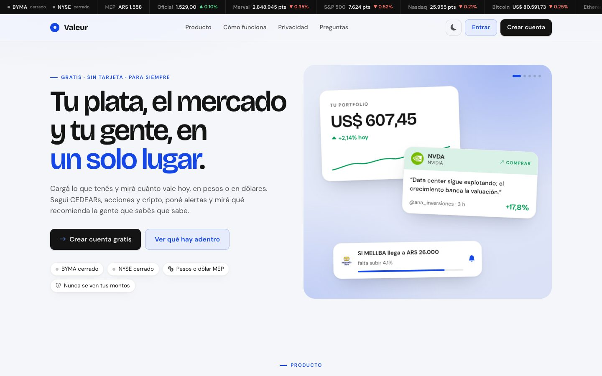
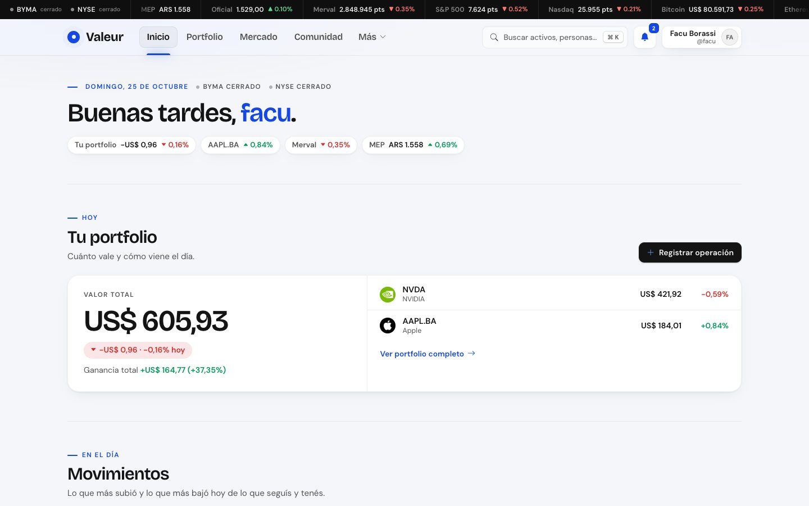
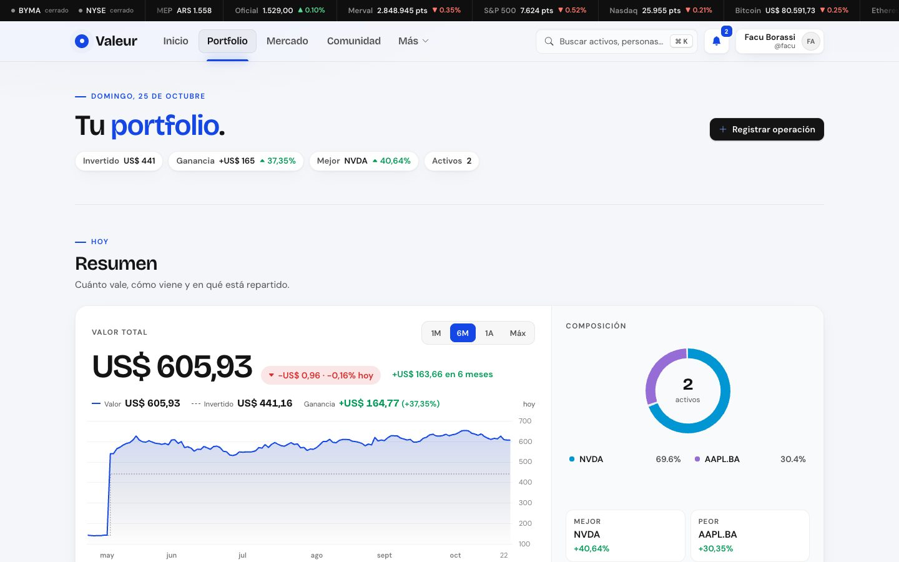
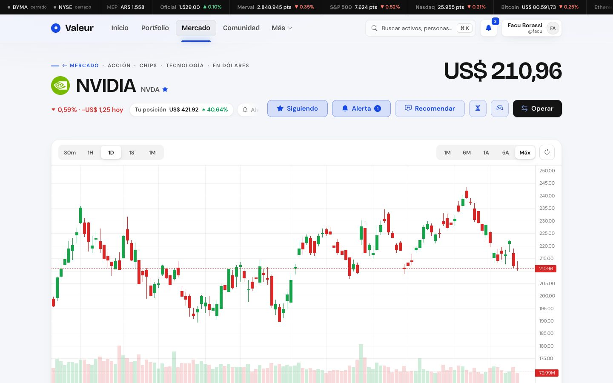
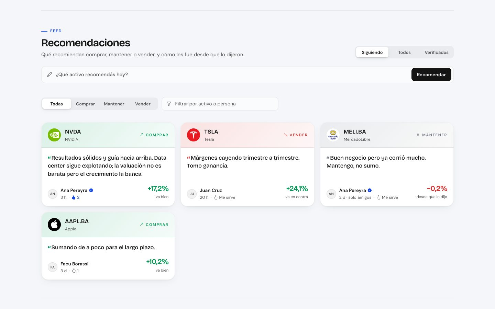
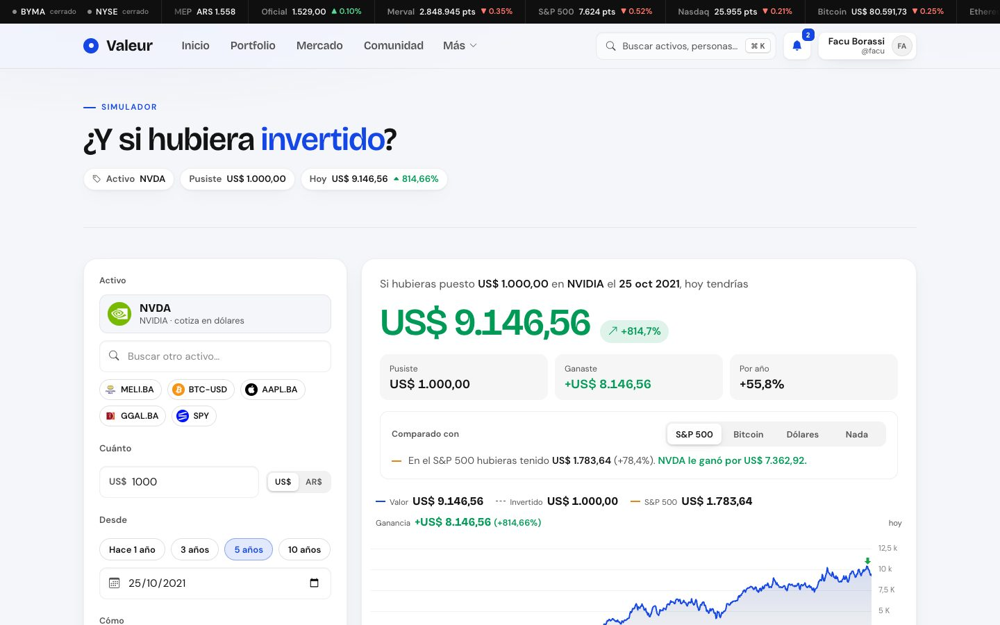
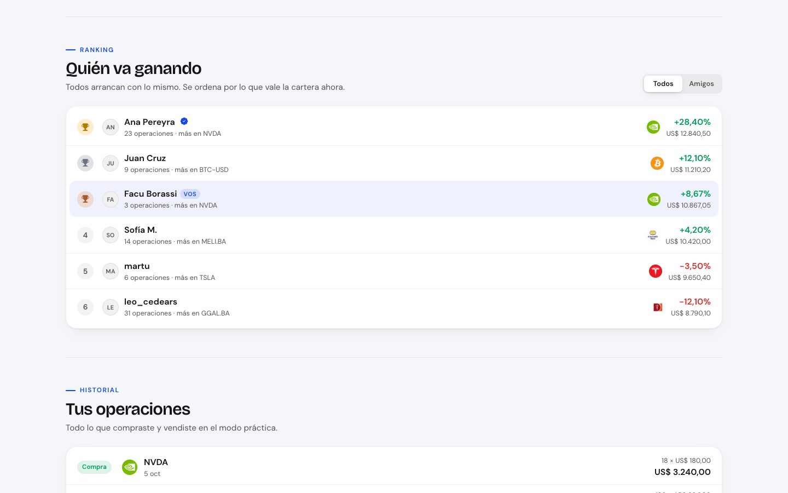
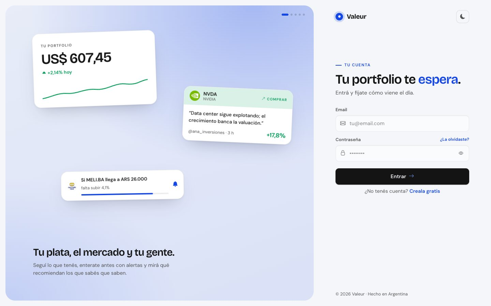
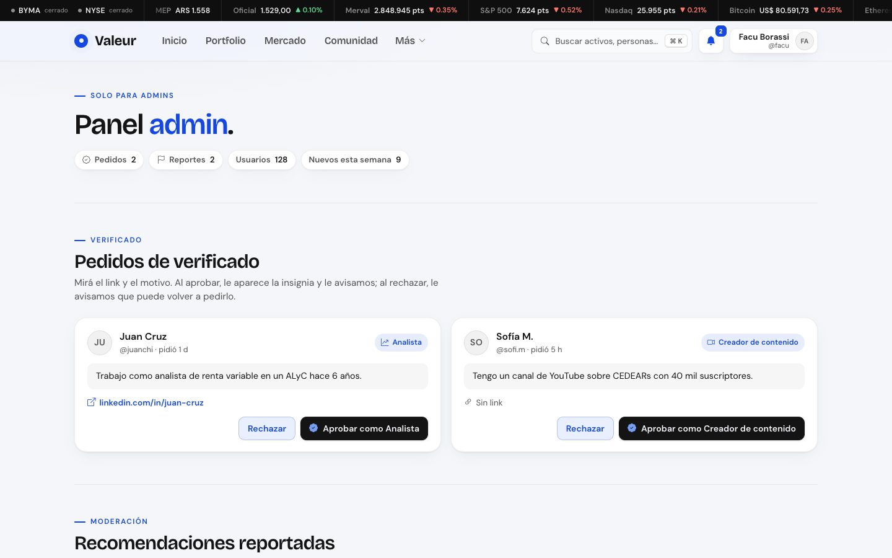

# Valeur

**Valeur** es una app web para seguir tus inversiones, el mercado y lo que recomienda tu gente, todo en un solo lugar. Está pensada para Argentina: CEDEARs, acciones locales y de EE.UU. y cripto, en pesos o en dólares (al dólar MEP).



---

## Qué tiene

| | |
|---|---|
| **Portfolio** | Cargás tus compras y ventas y ves cuánto vale todo hoy, en US$ o AR$. Evolución contra lo invertido, composición, ganancia por posición y exportar a Excel (CSV). |
| **Mercado** | CEDEARs, acciones, cripto y monedas con precio y variación del día, ideas "Para vos" según tus rubros, gráfico de velas con histórico completo y búsqueda. |
| **Alertas** | "Avisame si MELI llega a $26.000" o "si NVIDIA cae más de 4% en el día". Las revisa el backend cada 3 minutos, así avisan aunque no tengas la app abierta. |
| **Comunidad** | Recomendaciones (comprar, mantener o vender) que muestran cómo les fue desde que se dijeron, "me sirve", seguir gente, amigos (seguimiento mutuo), cuentas verificadas y reportes. |
| **Perfil y privacidad** | Elegís quién ve tu portfolio: nadie, tus amigos o todos. Nunca se muestran montos, solo porcentajes. |
| **Simulador** | "¿Y si hubiera invertido?": cuánto tendrías hoy con US$ 1.000 en NVIDIA hace 5 años (o $50.000 por mes en Galicia), comparado con el S&P 500, Bitcoin o guardar dólares. |
| **Modo práctica** | US$ 10.000 de mentira para comprar y vender al precio real, con un ranking de todos y de tus amigos. |
| **Panel admin** | Aprobar pedidos de verificado, revisar recomendaciones reportadas y ver los números de la app. |
| **Detalles** | Buscador ⌘K, notificaciones, modo oscuro, esqueletos de carga, instalable en el celu (PWA) y una 404 propia. |

<table>
  <tr>
    <td></td>
    <td></td>
  </tr>
  <tr>
    <td></td>
    <td></td>
  </tr>
  <tr>
    <td></td>
    <td></td>
  </tr>
  <tr>
    <td></td>
    <td></td>
  </tr>
</table>

---

## Cómo está hecho

```
                ┌──────────────────────────┐
  navegador ──► │  Front (React + Vite)    │
                │  Valeur/                 │
                └──────┬────────────┬──────┘
          datos, auth  │            │  precios, alertas, práctica
                       ▼            ▼
        ┌──────────────────┐   ┌───────────────────────────┐
        │ Supabase         │◄──│ Backend (Flask + yfinance)│
        │ Postgres + Auth  │   │ valeur-backend/           │
        │ (RLS en todo)    │   └─────────────┬─────────────┘
        └──────────────────┘                 ▼
                                      Yahoo Finance
```

| Capa | Tecnología |
|---|---|
| Front | React 19, Vite, React Router, lightweight-charts (gráficos), GSAP (animaciones), Bootstrap Icons |
| Datos y cuentas | Supabase: Postgres con Row Level Security, Auth (email y contraseña), triggers para las notificaciones |
| Backend | Python + Flask + yfinance: precios, velas, dólar MEP, revisión de alertas y modo práctica |

- **El front habla directo con Supabase** para todo lo que es de la cuenta. Cada tabla tiene políticas RLS: nadie puede leer ni tocar lo de otro.
- **El backend** da los precios (Yahoo Finance) y hace lo que necesita la *service role key*: revisar las alertas de todos y operar en el modo práctica con el precio real, para que nadie se invente un precio desde el navegador.
- **Dólar MEP:** Yahoo no tiene los bonos, así que se calcula con los CEDEARs en pesos y en dólares de la misma empresa (la mediana de varios pares por día).

```
Valeur/                    Front (React + Vite)
├── public/                íconos, manifest y service worker (PWA)
└── src/
    ├── pages/             una por pantalla: Home, Dashboard, Tickersearch, Community,
    │                      Profile, Simulator, Practice, Admin, Login, Register…
    ├── components/        AppShell (barra y menús), gráficos, modales, tarjetas…
    ├── lib/               datos: portfolio, mercado, comunidad, alertas, simulador, práctica
    ├── context/           sesión (AuthContext) y tema (ThemeContext)
    └── styles/            app.css, shell.css, social.css, landing.css
supabase/migrations/       las tablas, permisos y funciones, en orden (0001 a 0006)
valeur-backend/
├── backend.py             API de precios (y arranca el chequeo de alertas)
├── alerts.py              revisa las alertas de todos y deja la notificación
├── practice.py            modo práctica: operar al precio real y el ranking
├── supa.py                acceso a Supabase con la service role key
└── demo.py                carga (y borra) datos de ejemplo
docs/capturas/             las capturas de este README
```

---

## Levantarlo en tu compu

Necesitás **Node.js 18+**, **Python 3.9+** y un proyecto gratis en [supabase.com](https://supabase.com).

### 1. Supabase

1. Creá el proyecto.
2. En **SQL Editor**, pegá y corré **en orden** los archivos de `supabase/migrations/`:

   | Archivo | Qué crea |
   |---|---|
   | `0001_profiles.sql` | Perfiles y el trigger que lo crea al registrarse |
   | `0002_portfolio.sql` | Operaciones (`trades`) y activos seguidos (`watchlist`) |
   | `0003_community.sql` | Seguir y amigos, recomendaciones, portfolio compartido sin montos, verificados, alertas y notificaciones |
   | `0004_fix_accents.sql` | Corrige los acentos de las notificaciones |
   | `0005_admin.sql` | Admins, reportes y los números del panel |
   | `0006_practice.sql` | Modo práctica |

3. Hacete admin (una sola vez, con tu usuario después de registrarte):
   ```sql
   update public.profiles set is_admin = true where username = 'TU_USUARIO';
   ```
4. En **Authentication → URL Configuration → Redirect URLs** agregá `http://localhost:5173/nueva-clave` (para recuperar la contraseña).
5. En **Project Settings → API** vas a necesitar la **Project URL**, la **anon key** (para el front) y la **service_role key** (solo para el backend: es secreta).

### 2. Backend

```bash
cd valeur-backend
python3 -m venv venv
source venv/bin/activate          # en Windows: venv\Scripts\activate
pip install -r requirements.txt
cp .env.example .env              # y completá las variables de abajo
PORT=5002 python backend.py       # http://localhost:5002
```

| Variable | Para qué |
|---|---|
| `SUPABASE_URL` | La Project URL |
| `SUPABASE_SERVICE_ROLE_KEY` | La service_role key. Con esto andan las alertas con la app cerrada y el modo práctica |
| `ALERTS_EVERY` | Cada cuántos segundos se revisan las alertas (180 por defecto, mínimo 60) |
| `CORS_ORIGINS` | Otros orígenes permitidos además de localhost, separados por coma |

Al arrancar tiene que decir `[alertas] revisando cada 180 s`.

### 3. Front

```bash
cd Valeur
cp .env.example .env              # URL y anon key de Supabase, y la URL del backend
npm install
npm run dev                       # http://localhost:5173
```

| Variable | Para qué |
|---|---|
| `VITE_SUPABASE_URL` | La Project URL |
| `VITE_SUPABASE_ANON_KEY` | La anon key (es pública: la protege el RLS) |
| `VITE_MARKET_API` | La URL del backend, por ejemplo `http://localhost:5002/api` |

### 4. Datos de ejemplo (opcional)

Para mostrar la app con comunidad y ranking, el backend puede cargar usuarios de ejemplo con recomendaciones, seguidores, "me sirve" y jugadores en el modo práctica:

```bash
cd valeur-backend
python demo.py cargar --usuario TU_USUARIO   # los de ejemplo te siguen a vos
python demo.py borrar                        # saca todo lo de ejemplo
```

---

## API del backend

| Método | Ruta | Qué devuelve |
|---|---|---|
| `GET` | `/api/quote/<símbolo>` | Precio, variación y volumen |
| `GET` | `/api/batch?symbols=A,B,…` | Cotización y cierres del mes de varios a la vez |
| `GET` | `/api/candles/<símbolo>?interval=&range=` | Velas (de 30 minutos a mensuales, hasta todo el histórico) |
| `GET` | `/api/mep` | Dólar MEP de hoy y su historia |
| `GET` | `/api/search?q=` | Búsqueda de activos |
| `POST` | `/api/practice/trade` | Comprar o vender en el modo práctica (con la sesión del usuario) |
| `GET` | `/api/practice/ranking?scope=all\|friends` | Ranking del modo práctica |
| `GET` | `/api/health` | Si está andando |

---

## Comandos del front

| Comando | Qué hace |
|---|---|
| `npm run dev` | Servidor de desarrollo |
| `npm run build` | Build de producción |
| `npm run preview` | Ver el build |
| `npm run lint` | ESLint |

---

## Notas

- Los precios vienen de Yahoo Finance con demora. Lo que muestra Valeur es información, no asesoramiento financiero.
- Los `.env` no se suben al repo; usá los `.env.example` de plantilla.
- El simulador y el modo práctica no cuentan comisiones, impuestos ni dividendos.

---

Proyecto de Desarrollo de Sistemas 2026 · AGUILAR, BORASSI, SERALVO.
